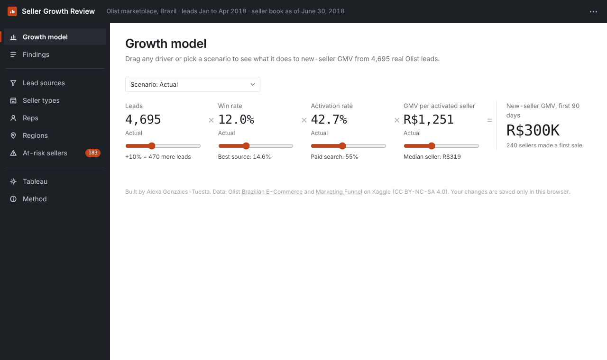
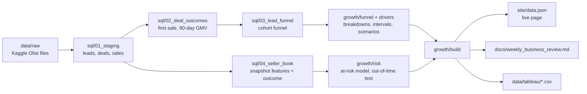

# SMB Growth Funnel Review

**A weekly business review for a sales team that signs small merchants: where the growth goal leaks between lead, signed seller, first sale and ramp, built on real marketplace data.**


### [Open the live review](https://alexagonzalestuesta.github.io/smb-growth-funnel-review/) | [Tableau Public dashboard](https://public.tableau.com/app/profile/alexa.gonzales.tuesta/viz/OlistSellerBook/Sellerbook)

Loads in about a second, no sign-up. Drag any driver, try the three scenarios, click a state, then check the at-risk seller list against what actually happened. Your changes stay in your own browser.



## Why this exists

Scaled sales teams, like the ones that onboard small advertisers or marketplace sellers, are usually measured on deals closed. But a signed account only creates revenue once it starts spending or selling. In this data, **57% of signed sellers never made a single sale in their first 90 days.** That gap is invisible in a deals-closed dashboard.

This project builds the review an analyst would bring to that team's weekly meeting: one goal broken into indicators each team owns, the size of each leak, and what to do about it.

The data is the real, public [Olist](https://www.kaggle.com/datasets/olistbr/marketing-funnel-olist) release: 8,000 marketing leads, 842 deals signed by 22 sales reps, and 99,441 marketplace orders from Brazil, 2016 to 2018. Nothing is simulated.

## What's different

* **The goal is an equation you can drag.** New-seller GMV = leads x win rate x activation rate x GMV per activated seller. Set a growth target and the page shows what each driver would need, then checks whether any real channel or seller group already performs at that level.
* **It refuses to rank people on noise.** Every rate has a 90% interval. Reps' activation ranges from 29% to 59%, but no rep is statistically different from the team, and the page says so instead of building a leaderboard.
* **The at-risk list is graded on the future.** The model is trained on the March 31 seller book and tested on the June 30 book, which it never saw. Flip one switch to see which flagged sellers really stopped selling.
* **It flags its own traps.** One seller produced 25% of new-seller GMV, so channels are compared on win and activation rates, not GMV per lead.
* **Also in Tableau.** The June 30 seller book is rebuilt as a [Tableau Public dashboard](https://public.tableau.com/app/profile/alexa.gonzales.tuesta/viz/OlistSellerBook/Sellerbook): headline KPIs, a map of sales at risk by state, at-risk share by state, and the flagged seller list, all linked by filter and highlight actions. It is embedded in the live page's Tableau dashboard tab, and the workbook is in `data/tableau/olist_seller_book.twbx`.
* **SQL first.** Every metric is a DuckDB SQL model over the raw Kaggle files. Python only runs the models and fits two logistic regressions.

## The 2-minute tour

1. Open the [live review](https://alexagonzalestuesta.github.io/smb-growth-funnel-review/).
2. Click **Buy 20% more leads**, then **Raise activation to the paid-search rate**. The second one is worth more (+30% vs +20%) and needs no new acquisition spend.
3. Leave **Growth target** at `30`. Win rate alone would need 15.6%, more than any tracked source wins; activation alone would need 55.5%, which large online sellers already beat.
4. Open **Lead sources**. Paid search is the only source whose signed sellers activate above the team rate.
5. Open **Regions** and click **PR** (Paraná): the second-largest state, GMV down 18% quarter over quarter, 29% of its sellers flagged. Click **See 30 at-risk sellers in Paraná**.
6. Turn on **Show what happened by August 28, 2018**.

## Results

All numbers are from the real data and regenerate with `python -m growth.build` and `python -m evals.run_evals`.

| Measure | Result |
|---|---|
| Lead cohort (Jan to Apr 2018) | 4,695 leads, 562 signed (12.0%), 240 made a first sale (42.7%), R$300K GMV in 90 days |
| Signed sellers who never sold in 90 days | **322 of 562 (57%)** |
| Raise activation to the paid-search rate (55%) | **+30% new-seller GMV**, vs +20% from buying 20% more leads |
| Sellers with no sale by day 30 who still sold by day 90 | 32% |
| At-risk model, tested on the unseen Jun 30 book | ROC AUC **0.76**; flagged sellers went dark **25%** of the time vs **8%** for the rest (**2.2x**) |
| Same-size spreadsheet rule (no sale in 21 days or orders halved) | 17% hit rate, 33% of dark sellers caught (model: 25%, 44%) |
| Activation predicted at signing | ROC AUC 0.69: lowest third 28% vs highest third 64%. Useful for ordering onboarding calls only |
| Data checks | 11 of 11 pass: row counts match Kaggle, funnel and GMV reconcile to raw order items, no lookahead |

Full write-ups: [weekly business review](docs/weekly_business_review.md) and [evaluation report](reports/eval_report.md).

## Findings, in one line each

1. 57% of signed sellers never made a sale. Track activation next to deals closed, per rep, every week.
2. Day 30 is the moment: only 32% of sellers with no sale by then sell by day 90. Call every new seller with no sale by day 21.
3. Offline stores (24%) and manufacturers (32%) activate far below resellers (49%). Give them a hands-on onboarding track.
4. Social leads close at 5.9% vs 12.0% overall. Tighten social lead qualification, and fix tracking: 15% of leads have no source.
5. One seller produced 25% of new-seller GMV. Judge channels and reps on rates, not GMV per lead.
6. Rep differences are within normal variation. Coach the process for everyone.
7. 183 still-active sellers flagged on June 30; 25% stopped selling vs 8% of the rest. Send the list to account managers every Monday.

## How it works



The live page is plain HTML, CSS and JavaScript in `site/`, with no framework and no build step. GitHub Actions rebuilds `site/data.json` from the raw files and deploys `site/` to GitHub Pages on every push.

## Run it locally (Windows Command Prompt)

Requires Python 3.9 or newer.

```
python -m venv .venv
.venv\Scripts\activate
pip install -r requirements.txt
python -m growth.build
python -m pytest -q
python -m evals.run_evals
cd site
python -m http.server 8000
```

Then open http://localhost:8000 in your browser. On macOS or Linux, activate with `source .venv/bin/activate`.

## Project structure

```
sql/                 DuckDB SQL models: staging, deal outcomes, lead funnel, seller book
growth/              Python: config (all windows), funnel, driver tree, risk model, regions, report, build
evals/run_evals.py   Data checks and model evaluation; exits 1 if any check fails
tests/               pytest: statistics, driver tree math, pipeline consistency, no lookahead, page data
site/                The live page (index.html, styles.css, app.js, data.json)
docs/                Metric definitions, weekly business review, Tableau guide, responsibilities map
data/raw/            Original Kaggle files (gzip)
data/tableau/        Tableau data source (seller_book.csv) and workbook (olist_seller_book.twbx)
reports/             Evaluation report and metrics
```

## Docs

* [Metric definitions: the indicator system](docs/metric_definitions.md)
* [Weekly business review (generated)](docs/weekly_business_review.md)
* [Evaluation report (generated)](reports/eval_report.md)
* [How the Tableau dashboard is built](docs/tableau_guide.md)
* [How this maps to a Data Business Analyst role](docs/responsibilities_map.md)

## Limitations and next steps

* **No cost data.** Sales effort, onboarding contacts and marketing spend aren't in the release, so scenarios show what a rate change is worth, not what it costs. Next: add cost per lead by source to turn scenarios into ROI.
* **Scenarios are not causal.** "Raise activation to the paid-search rate" says what that rate is worth; paid-search sellers may simply be different sellers. A real team would test an onboarding change with an A/B holdout before banking it.
* **Small samples.** 562 signed sellers in the cohort and 11 to 116 deals per rep. The intervals are honest about this, and most groups are "in line".
* **Regions describe the active book.** Seller locations only exist for sellers who sold, so the region view can't show where signed-but-inactive sellers are.
* **The activation-at-signing model is weak** (AUC 0.69). Next: add onboarding behavior from the first two weeks (catalog uploaded, first listing live), which would likely matter more than what sales knew at signing.
* **One marketplace, Brazil, 2018.** The method transfers; the rates don't.

## Why I built this

A good chunk of my family is Brazilian, so when I went looking for real data on how a sales team grows small merchants, the Olist dataset felt close to home. Olist connects small Brazilian businesses to the country's large online marketplaces, and every seller ID in this data is a real business that signed up hoping to sell. More than half of them never made a first sale, and I wanted to understand why.

I'm graduating from Purdue in December 2026 with degrees in Business Analytics and Information Management and in Marketing, and this project brings both together: the sales funnel and the data behind it. I hope it helps future Brazilian sellers, and the teams supporting them, get from signing up to their first sale faster.

## How I built it

I started from the business question, not the model: what does a scaled sales team need in its weekly review? I picked the cohort windows so every signed seller has a full 90 days of data, wrote the metrics as SQL models in DuckDB, and added a reconciliation check so the funnel GMV always ties back to raw order items. Small groups make it easy to tell false stories, so every rate carries a Wilson interval and nothing is called out without one. The at-risk model is a plain logistic regression, tested on a later snapshot it never saw and compared against a rule a team could run in a spreadsheet. The page is hand-built HTML, CSS and JavaScript, so it loads instantly on GitHub Pages and keeps each visitor's changes in their own browser.

## Data and license

Code: MIT. Data: Olist, [Brazilian E-Commerce](https://www.kaggle.com/datasets/olistbr/brazilian-ecommerce) and [Marketing Funnel](https://www.kaggle.com/datasets/olistbr/marketing-funnel-olist) datasets on Kaggle, CC BY-NC-SA 4.0, redistributed unchanged for non-commercial use. Font: Archivo, SIL Open Font License. See [LICENSE](LICENSE).

**Alexa Gonzales-Tuesta** | [LinkedIn](https://www.linkedin.com/in/alexa-gonzales-tuesta/) | [GitHub](https://github.com/AlexaGonzalesTuesta)
